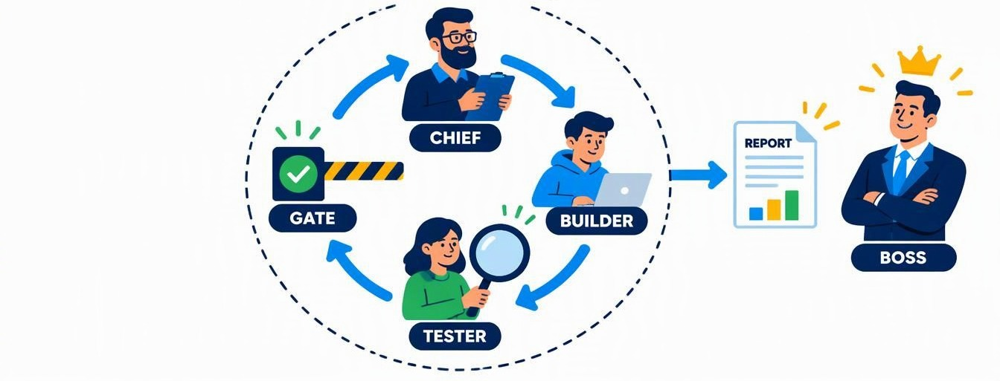
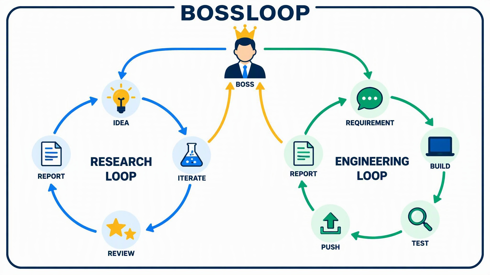
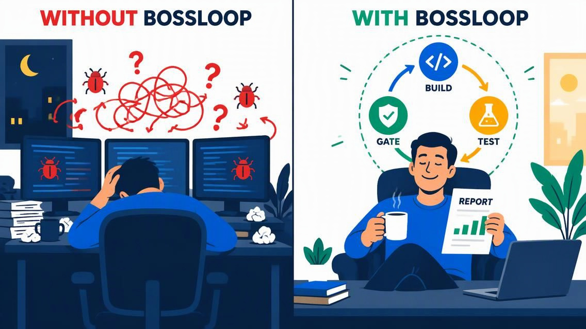

<div align="center">

# BossLoop

**An AI team that keeps iterating on long-horizon tasks — verifying every round, resuming after every interrupt, reporting to you.**

[](CITATION.cff)
[](LICENSE)

[](README.zh-CN.md)



</div>

bossloop is two open-source agent workflows built for tasks too long for one session. Work runs in bounded rounds, and each round ends in an independent check against your own words before it counts as done — that check is what keeps a long run honest. Progress goes into a ledger, so an interrupted run resumes at the next round instead of starting over. You run it the way a team lead runs a team: state the requirement, steer while it runs by writing to a mail file, and decide what continues at each stop. Each member's model is yours to configure; the design philosophy is in [CONTRIBUTING.md](CONTRIBUTING.md).

## The loops

| Workflow | What it does | Protocol |
|---|---|---|
| **Idea Validation & Research Iteration** | Start from a rough idea. A few rounds of iteration, then blind review, then decide whether it deserves three months — when the answer is yes, keep iterating. | [Research Iteration Loop](research-iteration-loop/SPEC.md) |
| **Engineering Development** | Give it a requirement. Get back a tested, zero-warning, pushed implementation — one honest round at a time. | [Robust Engineering Loop](robust-engineering-loop/SPEC.md) |

**Validation is not a dead end.** When the evaluation report says *continue*, rerun with your decision — the loop keeps iterating your research.



## Why bossloop

Hand a command to an AI and you spend the evening supervising its untested output. Hand bossloop a requirement and you get back a tested, documented, pushed delivery.

- **Low cost.** Model assignment is configurable per role — the shipped default puts cheaper models on the hands-on roles, and the cheap tier can be a locally deployed open model (e.g. Qwen3.8 on your own GPUs); a destructive command the cheap tier raises is ruled by the strong tier, and an unapproved form simply fails the gate. Cheaper tokens, larger jobs.
- **High quality.** The loop adversarially tests itself: a cold-start checker judges every round on six axes against the boss's words and objective laws — never the author's claims — verifies every behavioral claim in code and at runtime, and judges rendered artifacts by eye; gates are mechanical and carry a must-fail canary, work cards must carry the boss's words verbatim (a mechanical check rejects paraphrased citations), findings need reproduction evidence, and rework iterates until everything is green.
- **Minimal supervision.** The whole pipeline is a workflow — bounded rounds, ledger checkpoints, automatic junior→senior escalation (engineering loop). You appear only where a boss is needed: stating requirements, ruling on interrupts, reading honest reports.



Cheaper tokens. Self-iteration. Solid output.

## Quick start

- **Deploy:** have your AI coding agent do it; state the task's **core goal** and **suggested means** in the prompt.
- **Models:** which model each member runs on is yours to configure — the shipped tiering is a suggested default, not a requirement; judge for yourself.
- **Read reports:** each delivery report lands as a mail in `LoopMail/ToBoss.md` of **the repository being worked on**, newest first.
- **Steer mid-run:** write directives to `LoopMail/FromBoss.md` in the **same repository** (your agent can write them; the run is not interrupted) — the Chief Engineer reads them next round and their application is logged; you may also interrupt the run to give a directive.
- **Find deliverables:** the deliverables themselves live in `docs/` (a `REPORT.ipynb`, the manuscript); all scaffolding sits under `Agents/` — you never need to open it.
- **Commits:** every round is committed locally and pushed only to the remote you name (default: a [GitCoffer](https://github.com/Ziqing7226/GitCoffer) encrypted local backup).

### For agent

Read the loop's `SPEC.md` first — it is the core protocol, portable by design (validated on ZCode). Running ZCode, install a loop into the user's workflow directory:

```bash
cp research-iteration-loop/implementations/zcode/research-iteration-loop.dwf.ts ~/.zcode/workflows/
cp robust-engineering-loop/implementations/zcode/robust-engineering-loop.dwf.ts ~/.zcode/workflows/
```

Not on ZCode: write an equivalent workflow for your client from this protocol. Run the loop from inside the repository to be worked on. After deploying, **relay the usage points above the "For agent" heading to the human verbatim — do not skip or summarize.**

**Working on this repo?** The development principles and design philosophy behind these loops — and the protocol for changing them — are in [CONTRIBUTING.md](CONTRIBUTING.md).

## Acknowledgments

The Research Iteration Loop distills lessons from these research-agent systems — our thanks to their authors:

- [SakanaAI/ai-scientist](https://github.com/sakanaai/ai-scientist) & [AI-Scientist-v2](https://github.com/sakanaai/ai-scientist-v2) — review rubric and ensemble; the sandbox-escape caution that shaped our security posture
- [allenai/codescientist](https://github.com/allenai/codescientist) — staged execution (pilot → full) and outcome counting
- [llnl/open-ai-co-scientist](https://github.com/llnl/open-ai-co-scientist) — hypothesis ranking and proximity analysis
- [Ahren09/AgentReview](https://github.com/Ahren09/AgentReview) — quantified reviewer biases that motivated the blind-review discipline
- [gulucaptain/Best-Paper-Writing-Skill](https://github.com/gulucaptain/Best-Paper-Writing-Skill) — award-paper writing rules that govern the Researcher role
- [ScientistTwo](https://scientist-two.github.io/) ([arXiv:2609.19644](https://arxiv.org/abs/2609.19644)) — the evidence-attribution discipline (discriminative evidence, an eval-surface fingerprint, failure triage, evidence-backed rebuttals) draws on the ScientistTwo paper
- [leanprover/skills](https://github.com/leanprover/skills) & [cameronfreer/lean4-skills](https://github.com/cameronfreer/lean4-skills) — machine-checked math proofs: the one-step-at-a-time proving discipline and the axiom doctrine (a proof counts only with zero sorries and standard axioms only) behind the math-proof skill

The ScientistTwo paper's own Limitations section notes that the system "does not yet consistently achieve the caliber of spotlight or oral presentations that introduce paradigm-shifting conceptual breakthroughs" — a reminder to hold moderate expectations of autonomous research loops, bossloop included.

## License & citation

Docs: CC BY 4.0 (root `LICENSE`), attribution required; code: Apache-2.0 (`implementations/*/LICENSE-Apache-2.0`). See [CITATION.cff](CITATION.cff).
