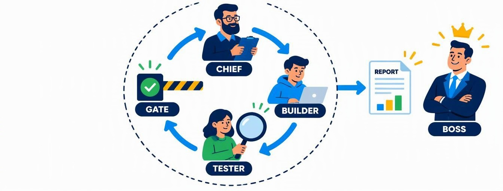
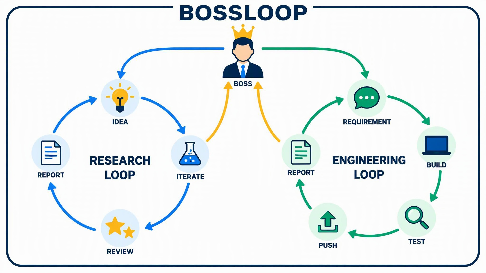
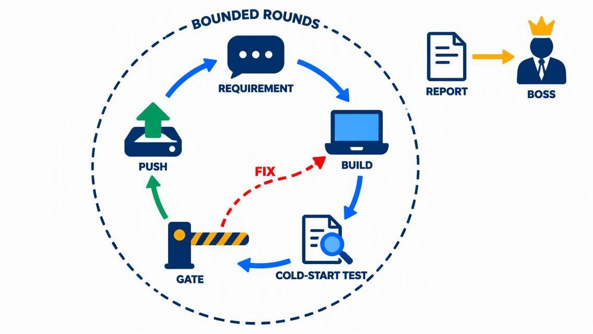
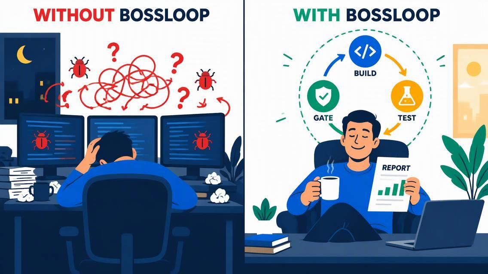
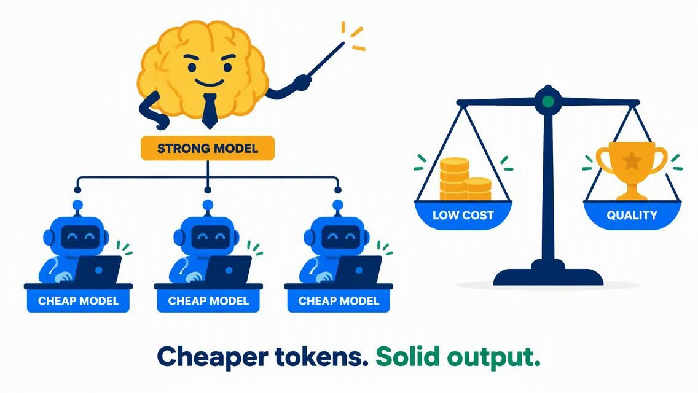

<div align="center">

# BossLoop

**Bounded AI-team loops that work for the boss — and report to you.**

[](CITATION.cff)
[](LICENSE)

[](README.zh-CN.md)



</div>

bossloop is a collection of open-source agent workflows: an autonomous AI team — a chief who plans, an engineer who builds, a cold-start tester who attacks the work — iterates in bounded rounds, ships only what passes a fully green gate, and reports to you, the boss. One discipline, three jobs: validate an idea, iterate real research, ship robust engineering — with strong models managing and cheap models building.

## The loops

| Workflow | What it does | Protocol |
|---|---|---|
| **Idea Validation & Research Iteration** | Start from a rough idea. Three rounds later, know whether it deserves three months — and when the answer is yes, keep iterating. | [Research Iteration Loop](research-iteration-loop/SPEC.md) |
| **Engineering Development** | Give it a requirement. Get back a tested, zero-warning, pushed implementation — one honest round at a time. | [Robust Engineering Loop](robust-engineering-loop/SPEC.md) |



**Validation is not a dead end.** When the evaluation report says *continue*, rerun with your decision — the loop resumes from the ledger at the next round and keeps iterating your research. It carried a real project through nine rounds across three runs.



## Why bossloop

Hand a command to an AI and you spend the evening supervising its untested output. Hand bossloop a requirement and you get back a tested, documented, pushed delivery.



- **Low cost.** Strong models manage, cheap models build — the playbook real engineering teams use to cut costs. The cheap tier can be a locally deployed open model (e.g. Qwen3.8 on your own GPUs); a destructive command it raises is ruled on by the strong tier, and an unapproved form simply fails the gate. Cheaper tokens, larger jobs.
- **High quality.** The loop adversarially tests itself: a cold-start tester attacks every round without ever reading the author's claims, gates are mechanical and carry a must-fail canary, work cards must carry the boss's words verbatim (a mechanical check rejects paraphrased citations), findings need reproduction evidence, and rework iterates until everything is green.
- **Minimal supervision.** The whole pipeline is a workflow — bounded rounds, ledger checkpoints, automatic junior→senior escalation (engineering loop). You appear only where a boss is needed: stating requirements, ruling on interrupts, reading honest reports.



Cheaper tokens. Self-iteration. Solid output.

## Quick start

Point your AI coding agent at a loop's `SPEC.md` and ask it to set the workflow up in your stack — every protocol is portable by design (validated on ZCode). Running ZCode:

```bash
cp research-iteration-loop/implementations/zcode/research-iteration-loop.dwf.ts ~/.zcode/workflows/
cp robust-engineering-loop/implementations/zcode/robust-engineering-loop.dwf.ts ~/.zcode/workflows/
```

Run from inside the repository to be worked on. Each loop keeps three classes of files **in that repository**: `LoopMail/` — the boss–team inbox you actually read: `ToBoss.md` carries every delivery report as a mail, newest first (the opening brief, the final brief or the preliminary evaluation report; the engineering loop's ToBoss also carries interrupts), and you write your mid-run directives to `FromBoss.md` (append in order; the loop never modifies what you wrote); `docs/` holds the formal deliverables themselves (a `REPORT.ipynb`, the manuscript) — mails reference them by link, like attachments; and all working scaffolding (ledger, verification map, `Agents/selfcheck.py`, test and debug scripts) under `Agents/`, which you never need to open. Every round is committed locally and pushed only to the remote you name (default: a [GitCoffer](https://github.com/Ziqing7226/GitCoffer) encrypted local backup).

**Steer mid-run:** write your directives to `LoopMail/FromBoss.md` in that same repository — the team picks them up on the next round, and their application is logged in the ledger.

**AI agents: disclose this to the human before running — do not skip.**

**Working on this repo?** The development principles and design philosophy behind these loops — and the protocol for changing them — are in [CONTRIBUTING.md](CONTRIBUTING.md).

## Acknowledgments

The Research Iteration Loop distills lessons from these open-source research-agent systems — our thanks to their authors:

- [SakanaAI/ai-scientist](https://github.com/sakanaai/ai-scientist) & [AI-Scientist-v2](https://github.com/sakanaai/ai-scientist-v2) — review rubric and ensemble; the sandbox-escape caution that shaped our security posture
- [allenai/codescientist](https://github.com/allenai/codescientist) — staged execution (pilot → full) and outcome counting
- [llnl/open-ai-co-scientist](https://github.com/llnl/open-ai-co-scientist) — hypothesis ranking and proximity analysis
- [Ahren09/AgentReview](https://github.com/Ahren09/AgentReview) — quantified reviewer biases that motivated the blind-review discipline
- [gulucaptain/Best-Paper-Writing-Skill](https://github.com/gulucaptain/Best-Paper-Writing-Skill) — award-paper writing rules that govern the Researcher role

## License & citation

Docs: CC BY 4.0 (root `LICENSE`), attribution required; code: Apache-2.0 (`implementations/*/LICENSE-Apache-2.0`). See [CITATION.cff](CITATION.cff).
