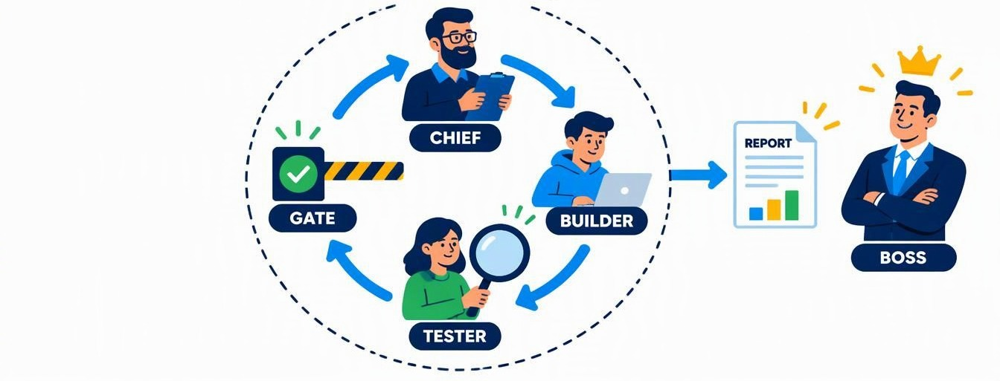
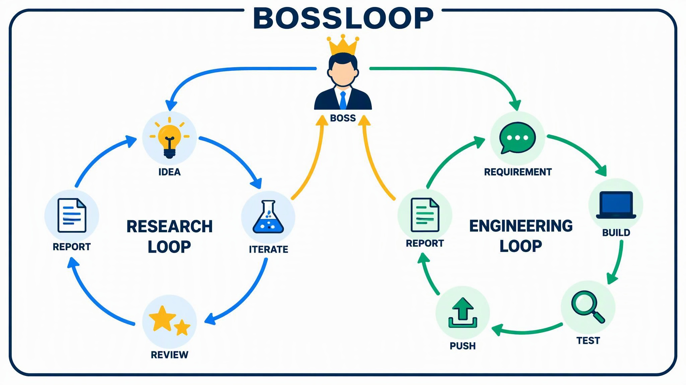
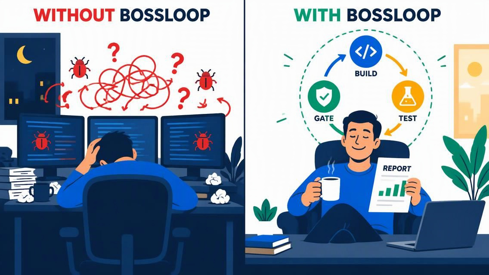

<div align="center">

# BossLoop

**一支在长周期任务上持续自主迭代的 AI 团队——每轮独立验证，中断后从断点续跑，并向你如实汇报。**

[](CITATION.cff)
[](LICENSE)

[](README.md)



</div>

bossloop 是两个开源 Agent 工作流，为一个会话装不下的长任务而做。工作分有界的轮次推进，每轮结束前都有一道对照你原话的独立检查，通过才算完成——这道检查让长跑保持诚实。进展写入账本，运行中断后从下一轮续跑，不必从头再来。你像团队 leader 带团队一样用它：用自己的话提出要求，运行中往一个邮件文件里写指令，到每个停点决定是否继续。每个成员接什么模型由你配置；设计哲学见 [CONTRIBUTING.md](CONTRIBUTING.md)。

## 工作流

| 工作流 | 它做什么 | 协议 |
|---|---|---|
| **观点验证与科研迭代** | 从一个粗糙的想法出发，迭代几轮之后盲审，再决定要不要投入三个月——答案是值得，就继续迭代下去。 | [科研迭代循环](research-iteration-loop/SPEC.md) |
| **工程开发** | 给它一条开发要求，还你一份已测试、零警告、已推送的实现——每一轮都诚实地推进。 | [鲁棒工程循环](robust-engineering-loop/SPEC.md) |

**验证不是终点。**当评估报告说「继续」，带着你的决策重跑即可——循环继续推进你的研究。



## 为什么是 bossloop

把一条命令交给 AI，你换来一份没测过的产出和一夜的督促；把要求交给 bossloop，你收获一份已测试、有文档、已推送的交付。

- **低成本。** 模型按角色自由配置——随附默认让更便宜的模型承担动手的活，廉价档也可以是本地部署的开源模型（例如在自己的 GPU 上跑 Qwen3.8）；廉价档提出的危险操作由强档裁决，未经批准的写法过不了门禁。省 token，办大事。
- **高质量。** 循环自我对抗：每轮都有冷启动检查者按六条判断轴对照老板原话与客观规律评判作品（绝不见作者自述）、逐条行为声称在代码与运行时双验、渲染产物以眼判、门禁全部机械化并埋必须失败的金丝雀、任务卡必须逐字携带老板原话（机械对拍拒绝转述引用）、问题必须附复现证据、返修迭代直到全绿。
- **少人工。** 全流程工作流化：有界轮次、账本断点、初级→高级自动升级（工程循环）；你只在老板该出场的地方出场——给要求、裁决打断、读汇报。



省 token，自迭代，好产出。

## 快速开始

- **部署**：让 AI 编码 Agent 来做；建议在提示词里说明任务的**核心目标**与**建议手段**。
- **模型**：每个成员接什么模型由你配置；默认分档只是建议——由你自行判断。
- **看汇报**：交付汇报以邮件形式出现在**要开发的仓库**的 `LoopMail/ToBoss.md`，新邮件在顶部。
- **运行中指挥**：运行中的指令写进**同一仓库**的 `LoopMail/FromBoss.md`（可让 Agent 代写；不打断运行），下一轮总工程师读取执行，应用记入账本；也可打断运行直接下指令。
- **找交付物**：交付物本体在 `docs/`（如 REPORT.ipynb、论文稿件）；全部脚手架在 `Agents/` 下，你不需要打开它。
- **提交推送**：每轮本地提交，只推送到你指定的 remote（默认为 [GitCoffer](https://github.com/Ziqing7226/GitCoffer) 本地加密备份）。

### 给 Agent

先读对应工作流的 `SPEC.md`——它是核心协议，按引擎可移植设计（已在 ZCode 验证）。使用 ZCode 时，把工作流装入用户的 workflow 目录：

```bash
cp research-iteration-loop/implementations/zcode/research-iteration-loop.dwf.ts ~/.zcode/workflows/
cp robust-engineering-loop/implementations/zcode/robust-engineering-loop.dwf.ts ~/.zcode/workflows/
```

不使用 ZCode 时，依据这份协议为所用客户端编写对应的工作流。在要开发的仓库内运行工作流。部署完成后，**把「给 Agent」标题之前的使用要点原话转述给用户，不得省略或概括。**

**要改这个仓库？** 这些循环背后的开发原则与设计哲学——以及修改它们的规程——见 [CONTRIBUTING.md](CONTRIBUTING.md)。

## 致谢

科研迭代循环提炼自以下科研智能体系统——感谢它们的作者：

- [SakanaAI/ai-scientist](https://github.com/sakanaai/ai-scientist) 与 [AI-Scientist-v2](https://github.com/sakanaai/ai-scientist-v2)——评审 rubric 与 ensemble；沙箱逃逸警示塑造了我们的安全姿态
- [allenai/codescientist](https://github.com/allenai/codescientist)——分级执行（pilot → full）与结论计数
- [llnl/open-ai-co-scientist](https://github.com/llnl/open-ai-co-scientist)——假设排名与相似度分析
- [Ahren09/AgentReview](https://github.com/Ahren09/AgentReview)——量化的审稿偏差，促成盲审纪律
- [gulucaptain/Best-Paper-Writing-Skill](https://github.com/gulucaptain/Best-Paper-Writing-Skill)——约束研究员角色的获奖论文写作规则
- [ScientistTwo](https://scientist-two.github.io/)（[arXiv:2609.19644](https://arxiv.org/abs/2609.19644)）——科研迭代循环的证据归因纪律（区分性证据、协议面指纹、失败三分类、以证据闭环的审稿回应）借鉴自 ScientistTwo 论文
- [leanprover/skills](https://github.com/leanprover/skills) 与 [cameronfreer/lean4-skills](https://github.com/cameronfreer/lean4-skills)——机器验证的数学证明：math-proof skill 背后的一步一验证明纪律与公理教义（零 sorry 且仅标准公理才算证明）

ScientistTwo 论文的 Limitations 一节自述该系统 "does not yet consistently achieve the caliber of spotlight or oral presentations that introduce paradigm-shifting conceptual breakthroughs"（尚未能稳定达到引入范式级概念突破的 spotlight 或 oral 水准）——对自主科研循环，包括 bossloop，都宜保持适度预期。

## 许可与引用

文档：CC BY 4.0（根 `LICENSE`），须署名；代码：Apache-2.0（`implementations/*/LICENSE-Apache-2.0`）。见 [CITATION.cff](CITATION.cff)。
