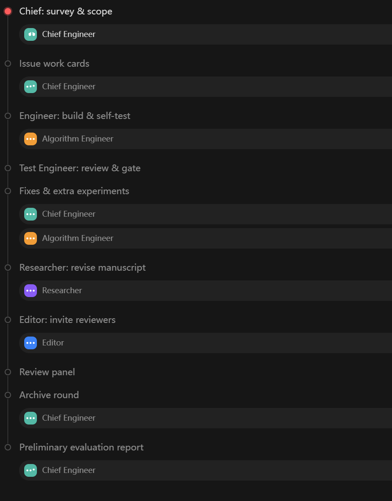

# Research Iteration Loop

**v0.2.8** · collection: `bossloop` · sibling: [Robust Engineering Loop](../robust-engineering-loop/SPEC.md)

> Start from a rough idea. Iterate it through bounded, adversarial cycles. Stop on schedule and report whether it deserves more of your life.

This protocol describes an AI research team that surveys, builds, tests, writes, and peer-reviews — then hard-stops and hands back an honest evaluation. It is portable by design (validated on ZCode); reference implementations live in `implementations/`.



---

## 1. Bound

Iterate, don't perfect. The loop **hard-stops after N rounds (default 3)** and produces a Preliminary Evaluation Report. A human decides what continues. Every round is a full peer-review cycle; the reviews double as the next round's plan.

## 2. Roles

| Role | Responsibility |
|---|---|
| **Chief Engineer** *(strong tier)* | Recover context from the ledger (resume, never redo); internalize the boss's requirements; survey (web + local paper library). Post a **paper-fetch request list** for inaccessible papers (non-blocking: proceed with lower confidence, don't stall). Maintain a **dynamic proposal portfolio**: re-select 1–3 proposals every round from the latest reviews (add, drop or replace; fill to 3 when choices exist, never 0) plus the competitor set (≤3). **Novelty handling:** if the idea turns out to be already done, do not stop — re-scope toward the unsolved gap inside that direction and run all remaining rounds. |
| **Algorithm Engineer** *(cheap tier)* | Build proposals / reproduce competitors. Real runs only; every number carries its exact definition. **Staged execution:** every new experiment runs MINI_PILOT (smoke) → PILOT (small-data correctness) → FULL (full-protocol comparison); stages before FULL are for debugging only — all archived numbers and claims come from FULL runs, and a minimal comparison passed off as validation is forbidden. **Freeze rule:** while the Test Engineer verifies, the implementation under test is not modified — a moving target makes the verdict void. **Zero-cost anchors & boundary probes:** before building a full method, representation and preprocessing assumptions are bounded with standard-tool anchor experiments; each round runs one boundary experiment (where the approach breaks), and every claim states its evidence scope — the datasets and conditions that back it. |
| **Test Engineer** *(cheap tier)* | Independent verification: code review; roundtrip incl. adversarial inputs; generalization across scenes/datasets; perturbation stability. Owns the claim→evidence map and the self-check. **Independence:** never edits the implementation under test — a verifier who fixes makes verification self-serving. |
| **Researcher** *(cheap tier)* | Revise the manuscript once per round (after engineering, before review); create the first draft if none exists. Only artifact-backed numbers; gaps stay explicit `[TODO]`. Follows award-paper writing rules: concrete openings, conditional gap statements, components that build on each other, ablations mapped to claims, a standalone Limitations section, no AI-style tells. |
| **Editor** *(strong tier)* | Extract keywords; invite reviewers from adjacent, non-overlapping fields — **how many (≤3) is the Editor's call** — plus 1 reader who has read every reference. Reviews must carry both issues and iteration proposals. **Blind-review discipline:** briefs are anonymized (no author/affiliation/project identity), reviewers never see each other's opinions (the orchestrator aggregates), and should the engine allow it, reviewers run on a different model than the builders — decorrelating reviewer and author error modes. Briefs stay tight: manuscript + claim map + targeted questions, never the whole repo. |
| **Reference Reader** *(strong tier)* | Read every reference; verify citations and narrative — including what each cited competitor actually does, not how surveys classify it. **Per-round novelty check (mandatory):** name the 3 closest existing works and state in which dimension the idea differs (problem setting / mechanism / scope) — evidence for the report, never a stop signal. |
| **Boss (human)** | Supply the idea and the project constraints; fetch requested papers; read the round-N report; decide continue / pivot / stop. |

The *orchestrator* is the engine layer that runs the loop (workflow runtime, script, or CI) — not a persona.

Why the engineer looks idle during testing: verification must be independent of authorship. The engineer's job in that window is to freeze the implementation, prepare the reproducibility package, and respond to gate failures.

## 3. One round

```
1  CHIEF     read ledger → resume point; survey web + local library
             └─ inaccessible papers → fetch-request list (non-blocking)
2  CHIEF     issue work cards: "reproduce competitor A", "try proposal 2", …
3  ENGINEER  build + self-test (implementation frozen from here)
4  TEST      independent verification + self-check + claim map → verdicts
5  CHIEF     dispatch fixes & extra experiments; ENGINEER executes
6  RESEARCHER revise (or create) the manuscript
7  EDITOR    keywords → invite adjacent-field reviewers + full-reference reader
8  ALL       append the round to the ledger and commit locally; if a local
             backup remote (GitCoffer) is configured, also push there
```

## 4. Transitions and the gate

- **Next round, no boss input**: the Chief turns review issues into task cards (each issue → a task or an explicit rebuttal-on-artifacts).
- **After round N: hard stop → Preliminary Evaluation Report** — verdict, expected success (labelled as a qualitative judgement expressed numerically, not a calibrated probability), novelty, impact, risks, each claim's evidence scope, a decision list for the boss (accounts, data, resources — things only the boss can do), reviewer verdicts quoted verbatim. Wait for the boss.
- **Round 1 must end with at least one end-to-end number from a properly powered comparison.** Toy or minimal comparisons that could bias conclusions do not count as validation — staged smoke/pilot runs exist for debugging only.

## 5. Evidence rules

1. **Claim→evidence map** (Test Engineer): every manuscript number ↔ an archived artifact + a re-runnable check. No map entry, no claim. *Write the check before building the claim.*
2. Meeting-note numbers ≠ archived numbers. Claimed edits are verified mechanically, never by paraphrase.
3. Survey/predictive numbers must survive an end-to-end run before entering any document.
4. Retraction is a normal action: log what was wrong, how it was caught, what is correct now — and sweep every document that repeats the retracted number (ledger history, READMEs, figures), fixing each within the same round.
5. **The gate has a canary**: at least one deliberately-broken control case that must FAIL, marked so the orchestrator can find it by search. A suite that cannot go red proves nothing — and self-reported quality is not a gate: both the canary and the claim map are **verified mechanically**, not taken on trust.
6. **Competitors carry fidelity anchors**: reproduction within plausible range of the published numbers, deviations documented. Whoever builds your method must not grade the competitors. **Before comparing against prior work, record a caliber table** — each competitor's raw convention, dataset, resolution and metric definition — and report headline numbers in convention-independent units where possible; cross-paper numbers are never compared without it.
7. **Experiment mortality is tracked and reported**: every round logs experiments attempted vs passed (honestly counting debug-stage deaths); the Preliminary Evaluation Report must cite this trend as evidence — a high debug mortality is itself a feasibility signal. Null results from work cards are archived with a mechanism explanation (why nothing was gained), never silently dropped — they bound the claim's scope.
8. **Dual-path recomputation, where it pays**: a number that enters a claim or a go/no-go decision and is produced by multi-step aggregation is recomputed via a second path from archived intermediates (a different grouping or formula — a second implementation is not required). Archive the intermediates that make this a minutes-long check, not a rerun. A mismatch freezes the number pending audit; it is never waved off as a rounding note. Single-source direct measurements are exempt — roundtrip and canary checks already cover them.

## 6. Safety for unattended runs

Subprocess per batch/scene; write results to disk immediately and exit to free memory; a hard memory cap and timeouts **in code**; staged pilot runs before full runs; datasets and existing artifacts read-only; cloud pushes are never automatic (local backup: see §7). Agent-written code is **untrusted**: prefer containerized or network-restricted execution where available — but treat containment as risk reduction, not a guarantee (sandbox escapes by capable code are a documented reality).

**Destructive operations are declared and adjudicated on cheap tiers, and the loop verifies its own bookkeeping:** the executor reports the commands it actually ran, compared against the approved forms; an unconfirmed execution is recorded honestly in the ledger. Deleting datasets, overwriting existing artifacts, `git reset --hard`, `git clean -fdx`, force pushes and rewrites of pushed history are declared (`dangerRequests`: command, reason, blast radius) and never run unilaterally; the **strong-tier Chief** rules each one — reject, a safer scoped form, or approve — and only the approved form runs. The ruling is not handed back to the boss: an experiment that cannot proceed at all without the operation is recorded as blocked in the ledger and surfaces in the Preliminary Evaluation Report.

## 7. Unattended runs and recovery

- The **ledger is the checkpoint**. Every round appends its task, artifacts, gate status, reviews and next direction.
- A run interrupted by a crash, a dropped model stream or a quota stop is **resumed, not restarted**: same run if the engine supports it, otherwise a fresh run reads the ledger and continues at round N+1 (the Chief reports `resumeFrom`).
- An external watchdog (cron, CI schedule) may poll run status and resume interrupted runs. It must **never** resume a run a human stopped on purpose.
- Every round is committed locally. **Recommended:** configure a local encrypted backup remote — [GitCoffer](https://github.com/Ziqing7226/GitCoffer) builds one — so each round is also pushed there; an agent that accidentally deletes or corrupts local code is then always recoverable without any cloud remote. Pushes to cloud/shared remotes are never automatic; publishing is the boss's explicit action.
- Because recovery depends on the ledger, a round that fails to append is the one failure that costs work.

## 8. Domain profiles

Project-specific constraints travel in a `profile` string injected into every role: hardware/memory ceilings, read-only data rules, forbidden practices (e.g. no simulators), required baselines, backup policy, language. This keeps one protocol usable across fields without forking it.

## 9. Model tiers

Roles run on two model tiers by default (`models=tiered`; `uniform` = session model for all): the **strong tier** carries the Chief, Editor, reviewers and Reference Reader — analysis and judgement; the **cheap tier** carries the Algorithm Engineer, Test Engineer and Researcher — hands-on work. Reviewers sitting on a different tier than the builders also satisfy the blind-review decorrelation rule (§2) structurally. Tier assignment is engine config, not protocol — any strong/cheap pair works, and the cheap tier may be a locally deployed model (e.g. Qwen4) where the engine allows it.

## 10. Configuration

| Parameter | Default | Note |
|---|---|---|
| `rounds` | 3 | total rounds before the hard stop |
| `idea` | — | required; the rough idea, one paragraph |
| `focus` | "" | the boss's note for this run |
| `profile` | "" | project constraints (see §8) |
| `models` | `tiered` | tiered = strong tier for Chief/Editor/reviewers/Reader, cheap tier for Engineer/Tester/Researcher; `uniform` = session model for all |
| proposal portfolio / competitors | re-selected every round | 1–3 proposals (never 0) + ≤3 competitors; Chief's call per round |
| max reviewers | 3 adjacent + 1 full-reference reader | bounds only — actual count is the Editor's call |

## 11. Implementations and scope

- **ZCode** — `implementations/zcode/*.dwf.ts`: ZCode-specific format; copy into `~/.zcode/workflows/` and run from inside the research repo. The gate calls `python selfcheck.py` and falls back to `python3` automatically. The Chinese-UI file is canonical; `*.en.dwf.ts` is protocol-identical.
- **Any framework** — roles → subagents, steps 1–8 → graph nodes or an orchestration script, the gate → a CI job, the ledger → a repo file, `profile` → project config. Portable by design; validated on one engine (ZCode).
- **Scope** — this repository ships the *iteration* protocol. A heavier deep-research variant (fixed specialist reviewer bench, domain guardrails) was field-tested on a real project over nine rounds in three runs; its lessons are folded into §5–§7. It is not included here. `claim_map` as a standardized JSON schema is a possible future extension.

## 12. License

Docs: **CC BY 4.0** — redistributing or adapting the documentation requires attribution; if the protocol helps your research, please cite the work (`../CITATION.cff`). Code (incl. `.dwf.ts`): **Apache-2.0**.
